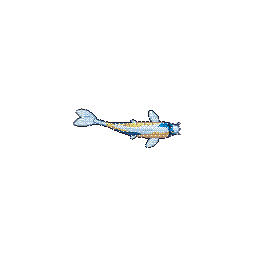

# hey, i'm yusef 🎣

ai student @ usf · linux tinkerer · probably fishing

building software, learning how things work, and occasionally breaking them.

**python · c · java · typescript · linux**

> code when the fish aren't biting

